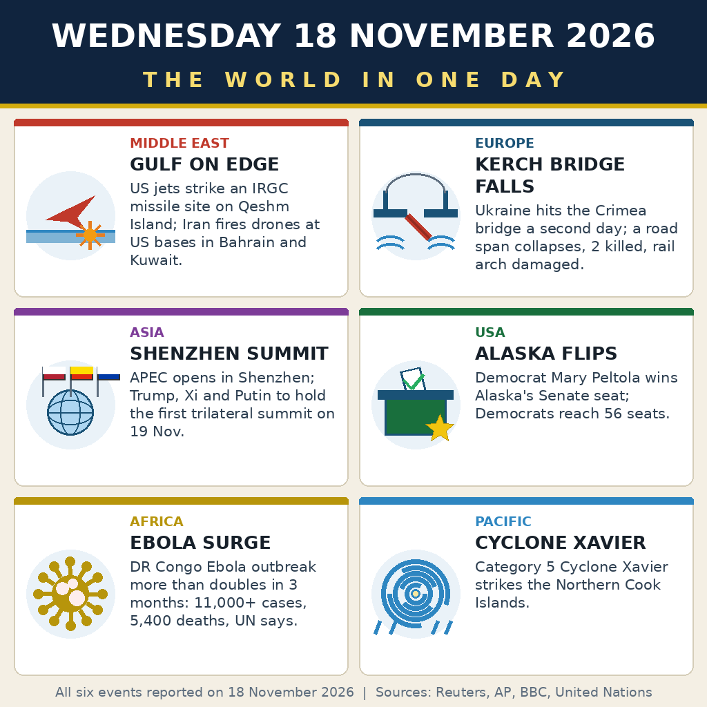

# The World in One Day — Wednesday 18 November 2026

[](https://make.fun/bounty/news-image-20261118?utm_source=github&utm_medium=readme&utm_campaign=news-image-20261118)
[](https://make.fun/bounty/news-image-20261118/leaderboard?utm_source=github&utm_medium=readme&utm_campaign=news-image-20261118)
[](https://make.fun/bounty/news-image-20261118?utm_source=github&utm_medium=readme&utm_campaign=news-image-20261118)

A make.fun entry for the **news-image-20261118** competition: one 1024×1024
image summing up the world news of Wednesday 18 November 2026.



## The six stories

1. **Gulf on edge (Middle East)** — US fighter jets struck an IRGC missile
   launch site on Qeshm Island in the Strait of Hormuz; Iran then fired
   drones at US forces in Bahrain (Sheikh Isa Air Base) and at Ali Al Salem
   Air Base in Kuwait. Gulf air defences intercepted them. *(Reuters)*
2. **Kerch Bridge falls (Europe)** — Ukraine hit the Crimea (Kerch) bridge a
   second day with drones and missiles; the road arch and a span collapsed
   into the strait, road traffic halted, 2 killed; the rail section still
   stands with a damaged arch. *(Reuters, BBC)*
3. **Shenzhen summit (Asia)** — APEC opens in Shenzhen; Trump, Xi Jinping and
   Putin meet there in the first-ever trilateral summit on 19 November; Trump
   was in Manila for Quad talks first. *(AP, Reuters)*
4. **Alaska flips (USA)** — Democrat Mary Peltola wins Alaska's US Senate
   seat, beating incumbent Dan Sullivan; Democrats reach 56 Senate seats.
   *(AP)*
5. **Ebola surge (Africa)** — DR Congo's Ebola outbreak more than doubles in
   three months: 11,000+ cases, 5,400 deaths, the UN says. *(United Nations)*
6. **Cyclone Xavier (Pacific)** — Category 5 Cyclone Xavier hits the Northern
   Cook Islands.

Every story was reported on 18 November 2026. The image names the date
prominently and shows each story with a drawn icon, a headline and one
factual line.

## How it works

`main.py` (Python 3.13, standard library only, no network) copies the
pre-rendered `entry.png` into `$MAKEFUN_OUTPUT_DIR` (default `/output`):

```sh
MAKEFUN_OUTPUT_DIR=out python3 main.py   # writes out/entry.png
```

The image itself was drawn with a small PIL render script (DejaVu fonts,
drawn shapes only — no photos, no copied artwork). It is 1024×1024 PNG,
under 1 MiB, and deterministic: both runs of `main.py` write identical bytes.

## License

MIT — see [LICENSE](LICENSE).
